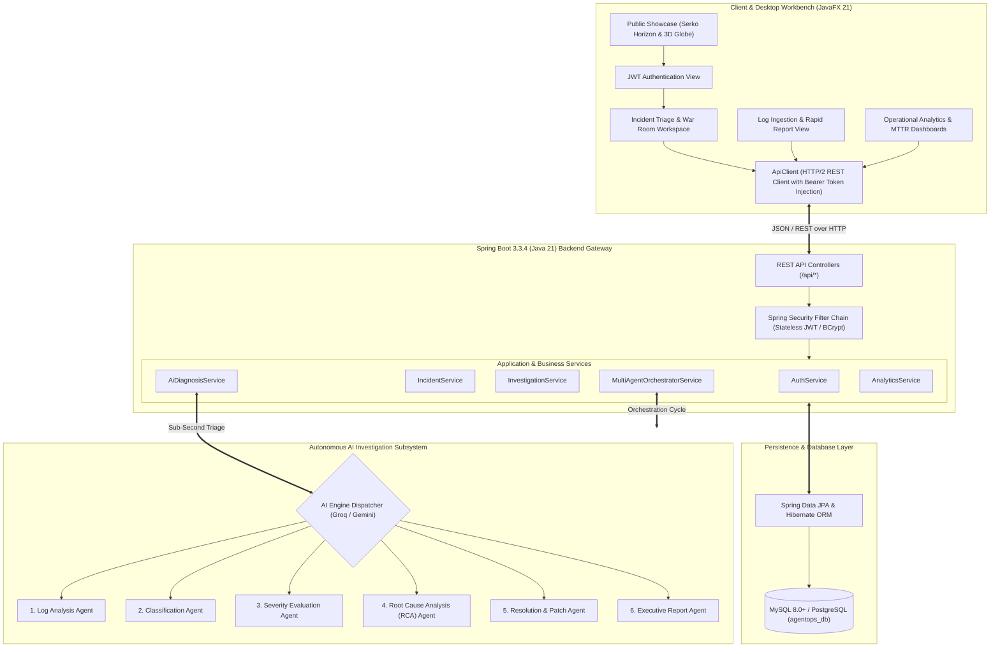
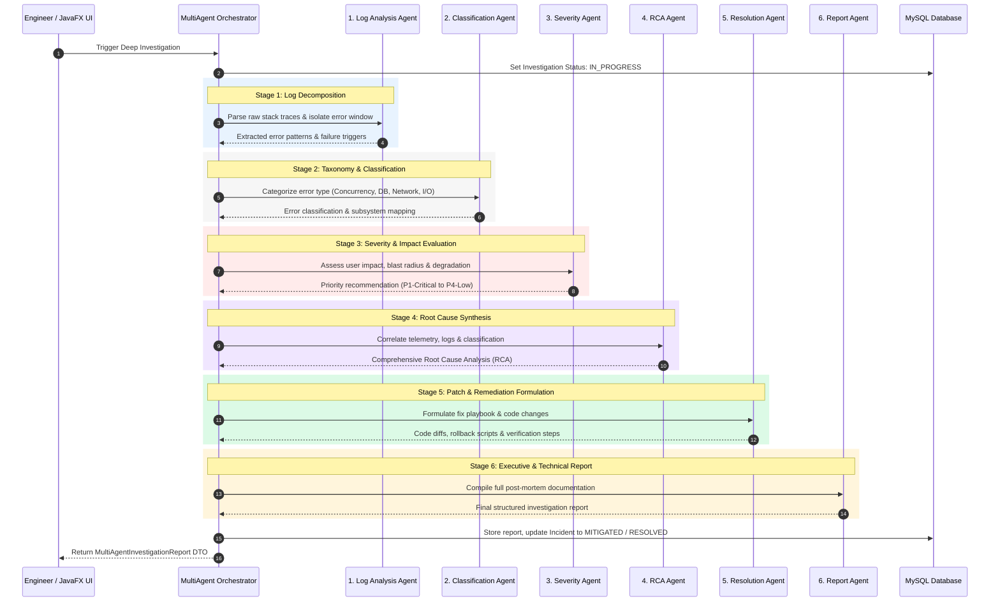
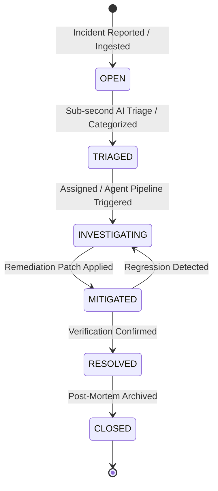

# ⚡ IncidentIQ (AgentOps)

> **Centralized AI-Powered Incident Management & Autonomous Multi-Agent Investigation Platform**

[](https://openjdk.org/)
[](https://spring.io/projects/spring-boot)
[](https://openjfx.io/)
[](https://www.mysql.com/)
[](https://groq.com/)
[](https://ai.google.dev/)
[](LICENSE)

---

## 📖 Table of Contents

1. [Executive Overview](#-executive-overview)
2. [The Core Problem & The IncidentIQ Solution](#-the-core-problem--the-incidentiq-solution)
3. [System Architecture](#-system-architecture)
4. [Autonomous 6-Agent Investigation Pipeline](#-autonomous-6-agent-investigation-pipeline)
5. [Key Platform Features & Pillars](#-key-platform-features--pillars)
6. [UI Design & Visual Showcase](#-ui-design--visual-showcase)
7. [Technology Stack](#-technology-stack)
8. [Repository Structure](#-repository-structure)
9. [REST API Documentation](#-rest-api-documentation)
10. [Getting Started & Installation](#-getting-started--installation)
    - [Prerequisites](#prerequisites)
    - [Environment Configuration](#environment-configuration)
    - [Database Initialization](#database-initialization)
    - [Running the Backend Service](#running-the-backend-service)
    - [Launching the JavaFX Desktop UI](#launching-the-javafx-desktop-ui)
    - [Running the Automated Test Suite](#running-the-automated-test-suite)
11. [Configuration Reference](#-configuration-reference)
12. [Contributing & License](#-contributing--license)

---

## 🌟 Executive Overview

In contemporary distributed architectures, production incident management is critically fragmented. Site Reliability Engineers (SREs) and software teams are forced to swivel across disconnected log aggregators (Elasticsearch, CloudWatch), APM traces (Datadog, OpenTelemetry), issue trackers (Jira, ServiceNow), and team messaging channels (Slack, Teams). This manual context switching compounds **Mean Time to Acknowledge (MTTA)** and **Mean Time to Resolve (MTTR)**, turning preventable degradations into prolonged outages.

**IncidentIQ (AgentOps)** provides a unified, centralized, and AI-native incident operations platform. Backed by a high-throughput **Spring Boot 3.3.4 (Java 21)** REST backend and an editorial-grade **JavaFX 21** desktop workbench, IncidentIQ bridges the gap between raw error telemetry and actionable resolution through:
- **Instant Sub-Second Single-Shot AI Triage** (via Groq Llama-3.3 / Google Gemini)
- **Autonomous Multi-Agent Investigation Pipelines** (orchestrated 6-agent collaborative diagnostic teams)
- **Real-Time Incident Lifecycle Management & SLA Tracking**
- **Collaborative Engineering War Rooms with Audit Trails**
- **Interactive MTTR/MTTA Operational Telemetry Dashboards**

---

## 🎯 The Core Problem & The IncidentIQ Solution

```mermaid
flowchart LR
    subgraph Traditional Workflow [Legacy Fragmented Incident Workflow]
        direction TB
        L1[Raw Stack Traces & Logs] --> L2[Manual Search in CloudWatch/ELK]
        L2 --> L3[Manual Code Crawling in GitHub]
        L3 --> L4[Ad-hoc Slack War Rooms]
        L4 --> L5[Hours to Identify Root Cause]
    end

    subgraph IncidentIQ Platform [IncidentIQ AI-Orchestrated Workflow]
        direction TB
        I1[Error Logs Ingested] --> I2[Sub-Second AI Triage]
        I2 --> I3[6-Agent Autonomous Pipeline]
        I3 --> I4[Evidence-Grounded RCA & Patch]
        I4 --> I5[Instant Resolution & Knowledge Base RAG]
    end

    Traditional Workflow -.->|Transformed by IncidentIQ| IncidentIQ Platform
```

| Operational Challenge | Legacy / Traditional Approach | IncidentIQ AI-Driven Solution |
|---|---|---|
| **Log Triage** | Grepping megabytes of unstructured text across log collectors | Automated parsing, anomaly isolation, and semantic error categorization |
| **Root Cause Analysis** | Manual hypothesis generation by senior engineers over hours | 6-agent cross-synthesizing pipeline identifying trigger, faulty code, and impact in seconds |
| **Remediation** | Scouring outdated wikis and documentation | Automated generation of exact code diffs, shell rollback scripts, and remediation playbooks |
| **Incident Tracking** | Static ticket entries detached from real execution context | Real-time lifecycle state engine with SLA timers, severity prioritization, and comment war rooms |
| **Post-Mortem & Memory** | Retrospectives forgotten in static doc repositories | Ingested into vector knowledge base (RAG) to ground future investigation accuracy |

---

## 🏗️ System Architecture

IncidentIQ is architected with clear domain separation between the high-performance Spring Boot REST core, the multi-agent AI orchestration engine, persistence layers, and the native JavaFX desktop client.



---

## 🤖 Autonomous 6-Agent Investigation Pipeline

When an incident is escalated or an in-depth investigation is triggered via `POST /api/agents/incidents/{id}/investigate`, the **MultiAgentOrchestratorService** launches a 6-stage autonomous agent pipeline:



### Detailed Agent Roles

| Agent | Responsibility | Core Output |
|---|---|---|
| **1. Log Analysis Agent** | Strips noisy telemetry, parses multi-line Java/Python/Node stack traces, and isolates the anomalous execution window. | Clean error signatures, timestamp bounds, and active threads. |
| **2. Error Classification Agent** | Categorizes the failure taxonomy (e.g., `NullPointerException`, `Deadlock`, `ConnectionTimeout`, `ResourceExhaustion`). | Subsystem tag, error hierarchy, and affected microservices. |
| **3. Severity Evaluation Agent** | Cross-references affected endpoints against SLA commitments and user degradation scope. | Calculated severity rating (`P1` to `P4`) with impact rationale. |
| **4. Root Cause Analysis (RCA) Agent** | Synthesizes all gathered evidence to establish the causal chain: Trigger Event $\to$ Broken Invariant $\to$ Visible Failure. | Detailed, non-hallucinatory root cause statement with confidence score. |
| **5. Resolution & Patch Agent** | Formulates exact remediation procedures, code patches, configuration tweaks, and rollback commands. | Unified diff patch, execution safety warnings, and smoke tests. |
| **6. Report Generation Agent** | Generates executive summaries for engineering managers and technical deep-dives for developers. | Standardized Post-Mortem ready for export and knowledge base archiving. |

---

## 💎 Key Platform Features & Pillars

### 1. Incident Management Dashboard & Lifecycle Engine
- **Strict State Transition Machine:** `OPEN` $\to$ `TRIAGED` $\to$ `INVESTIGATING` $\to$ `MITIGATED` $\to$ `RESOLVED` $\to$ `CLOSED`.
- **Severity-Based Priority Queuing:** `P1` (Critical Outage), `P2` (High Degradation), `P3` (Medium Impairment), `P4` (Minor Bug).
- **Ownership & SLA Tracking:** Real-time assignment to engineers, escalation flags, and resolution countdowns.



### 2. Dual-Engine AI Intelligence
- **Sub-Second Single-Shot AI Triage (`/api/ai/incidents/{id}/diagnose`):** Instant diagnosis powered by Groq's low-latency inference engine (or Gemini API) for on-call engineers needing immediate answers in under 1 second.
- **Deep Autonomous Multi-Agent Investigation (`/api/agents/incidents/{id}/investigate`):** Thorough multi-agent pipeline executing structured diagnostic reasoning.

### 3. Collaborative Incident War Room
- Embedded comment stream and activity log for every incident.
- Timestamped audit trail recording all human notes, status changes, and AI agent diagnostic outputs.
- Markdown-supported collaborative documentation.

### 4. Real-Time Operational Analytics
- Tracks **Mean Time to Acknowledge (MTTA)** and **Mean Time to Resolve (MTTR)**.
- Severity distribution breakdown charts (P1 through P4).
- Total incident volume, resolution velocity, and AI diagnosis coverage rates.

### 5. Knowledge Base & RAG Readiness
- Architecture designed for vector embeddings and document indexing (historical incidents, company runbooks, architectural RFCs) to ground AI responses with zero hallucinations.

---

## 🎨 UI Design & Visual Showcase

The IncidentIQ desktop UI is modeled after the **Serko.ai** editorial aesthetic:
- **Atmospheric Sky-to-Sunset Aura:** Light theme featuring pure white canvases, subtle frost surfaces (`#F6F6F6`), and crisp horizon gradients (`#1B98F2` to `#CF69E0` and `#F56293`).
- **Pill Geometry:** Universal `999px` capsule navigation switchers, action triggers, and status chips.
- **Interactive 3D Telemetry Globe:** HTML5 Canvas / WebGL globe embedded seamlessly in JavaFX WebView on the showcase landing view.
- **Split-Pane Incident Queue:** Ergonomic desktop view allowing engineers to browse incidents while inspecting live logs, RCA findings, and comments simultaneously.

### UI Screenshots

| View | Screenshot |
|---|---|
| **Public Showcase & 3D Globe** |  |
| **Platform Architecture** |  |
| **Authentication & Access** |  |
| **Incident War Room Queue** |  |
| **Incident Ingestion & Report** |  |
| **Operational Analytics & MTTR** |  |

---

## 💻 Technology Stack

| Layer | Component | Version / Description |
|---|---|---|
| **Backend Framework** | Spring Boot | `3.3.4` (Spring Web, Spring Security, Spring Data JPA, Validation) |
| **Language Runtime** | Java JDK | `Java 21` LTS (Virtual Threads, Records, Pattern Matching) |
| **Security & Auth** | JJWT & Spring Security | Stateless JWT (HS256), BCrypt Password Encryption, Role-Based Access Control |
| **Persistence / ORM** | MySQL / PostgreSQL | Hibernate ORM, Spring Data JPA Repositories |
| **Desktop Client** | JavaFX | `JavaFX 21.0.2` (Controls, FXML, WebKit WebView for 3D Globe) |
| **Typography** | Plus Jakarta Sans | Bundled geometric sans (`Bold`, `SemiBold`, `Medium`, `Regular`) |
| **Primary AI Engine** | Groq API | Ultra-fast LPU inference (`llama-3.3-70b-versatile`, `gpt-oss-20b`) |
| **Secondary AI Engine**| Google Gemini API | `Gemini 1.5 Pro / Flash` via REST client |
| **Build System** | Apache Maven | `Maven 3.9+` wrapper (`mvnw`, `mvnw.cmd`) |

---

## 📁 Repository Structure

```
AgentOps/
├── .env.example                       # Template for environment variables and secrets
├── .gitignore                         # Comprehensive Git ignore rules (build, secrets, IDE)
├── DESIGN.md                          # Design system specification (colors, typography, geometry)
├── IncidentIQ_Project_Report.pdf      # Detailed project report & system documentation
├── PRODUCT.md                         # Product specification, user personas, and capabilities
├── PROJECT_SPEC.md                    # Core architecture specification and domain definitions
├── README.md                          # Primary platform documentation
├── run_demo.ps1                       # Interactive end-to-end PowerShell demo runner
├── start_backend.bat                  # One-click Windows batch backend launcher
├── start_backend.ps1                  # One-click PowerShell backend launcher
├── start_ui.bat                       # One-click Windows batch JavaFX UI launcher
├── start_ui.ps1                       # One-click PowerShell JavaFX UI launcher
├── test_suite.ps1                     # Comprehensive automated REST API test suite
├── .impeccable/                       # UI design system assets and review screenshots
│   ├── design.json                    # Machine-readable design tokens
│   └── review/                        # High-resolution screenshots of all UI views
└── agentops/                          # Spring Boot & JavaFX Application Root
    ├── pom.xml                        # Maven dependencies & build lifecycle configuration
    ├── mvnw / mvnw.cmd                # Cross-platform Maven wrappers
    ├── run-ui.ps1                     # UI execution script with local repository support
    └── src/
        ├── main/
        │   ├── java/com/agentops/
        │   │   ├── AgentopsApplication.java     # Spring Boot application entrypoint
        │   │   ├── Config/                      # App Beans, PasswordEncoder, CORS configs
        │   │   ├── Controllers/                 # REST Endpoints (Auth, Incidents, AI, Agents)
        │   │   ├── DTO/                         # Request/Response contracts & payload models
        │   │   ├── Exceptions/                  # Global exception handling & custom errors
        │   │   ├── Models/                      # JPA Entities (User, Incident, Investigation)
        │   │   ├── Repositories/                # Spring Data JPA Repository interfaces
        │   │   ├── Security/                    # JWT Filters, JwtUtils, UserDetailsService
        │   │   ├── Services/                    # Core business & multi-agent orchestration
        │   │   └── UI/                          # JavaFX Desktop Application
        │   │       ├── IncidentIqApp.java       # JavaFX Application Shell & Navigator
        │   │       ├── Launcher.java            # Main entrypoint for JAR execution
        │   │       ├── ApiClient.java           # Desktop-to-Backend HTTP REST bridge
        │   │       ├── Views/                   # JavaFX Views (Home, Incidents, Analytics, etc.)
        │   │       └── Models/                  # Table and UI observable data models
        │   └── resources/
        │       ├── application.properties       # Spring Boot runtime configuration
        │       ├── css/app.css                  # Serko-inspired CSS styling rules
        │       ├── fonts/                       # Embedded Plus Jakarta Sans TTF fonts
        │       └── web/hero-globe.html          # Embedded HTML5 Canvas 3D wireframe globe
        └── test/                                # JUnit 5 and Spring Boot integration tests
```

---

## 📡 REST API Documentation

All secured endpoints require the HTTP header:  
`Authorization: Bearer <JWT_TOKEN>`

### 1. Authentication Endpoints

| Method | Endpoint | Access | Description |
|---|---|---|---|
| `POST` | `/api/register` | Public | Register a new user (`name`, `email`, `password`, `role`) |
| `POST` | `/api/login` | Public | Authenticate with credentials and receive a JWT token |

#### Register Request Sample
```json
POST /api/register
Content-Type: application/json

{
  "name": "Jane Doe",
  "email": "jane.doe@company.internal",
  "password": "StrongPassword123!",
  "role": "ROLE_ENGINEER"
}
```

#### Login Response Sample
```json
{
  "token": "eyJhbGciOiJIUzI1NiIsInR5cCI6IkpXVCJ9...",
  "type": "Bearer",
  "email": "jane.doe@company.internal",
  "name": "Jane Doe",
  "role": "ROLE_ENGINEER"
}
```

---

### 2. Incident Management Endpoints

| Method | Endpoint | Access | Description |
|---|---|---|---|
| `GET` | `/api/incidents` | Authenticated | Retrieve all incidents (supports filtering by `status`, `severity`) |
| `POST` | `/api/incidents` | Authenticated | Create a new incident with title, description, severity, and logs |
| `GET` | `/api/incidents/{id}` | Authenticated | Retrieve details of a specific incident |
| `PUT` | `/api/incidents/{id}` | Authenticated | Update incident details, status, severity, or assignee |
| `DELETE` | `/api/incidents/{id}` | Authenticated | Remove an incident record |
| `POST` | `/api/incidents/{id}/comments` | Authenticated | Add a collaborative investigation comment or note |
| `GET` | `/api/incidents/{id}/comments` | Authenticated | List all comments associated with an incident |

#### Create Incident Request Sample
```json
POST /api/incidents
Content-Type: application/json
Authorization: Bearer <JWT_TOKEN>

{
  "title": "PaymentGatewayTimeout: Connection reset during checkout",
  "description": "Checkout service experiencing 504 Gateway Timeouts under spike load.",
  "severity": "P1",
  "logs": "java.net.SocketTimeoutException: Read timed out at com.checkout.GatewayClient.execute(GatewayClient.java:142)..."
}
```

---

### 3. AI Triage & Multi-Agent Investigation

| Method | Endpoint | Access | Description |
|---|---|---|---|
| `POST` | `/api/ai/incidents/{id}/diagnose` | Authenticated | Sub-second single-shot AI triage via Groq / Gemini |
| `POST` | `/api/agents/incidents/{id}/investigate` | Authenticated | Execute the autonomous 6-agent investigation pipeline |
| `GET` | `/api/investigations/{id}` | Authenticated | Fetch full investigation state and generated RCA report |

#### Single-Shot AI Diagnosis Response Sample (`/api/ai/incidents/{id}/diagnose`)
```json
{
  "incidentId": 14,
  "summary": "Socket timeout caused by thread pool exhaustion in checkout gateway connector.",
  "rootCause": "HikariCP connection pool was capped at 10 connections while incoming requests surged to 250 req/sec.",
  "suggestedSeverity": "P1",
  "recommendedAction": "Increase connection pool maximumSize to 50 and implement circuit breaker pattern in GatewayClient.",
  "confidenceScore": 0.94
}
```

#### Multi-Agent Pipeline Response Sample (`/api/agents/incidents/{id}/investigate`)
```json
{
  "investigationId": 8,
  "incidentId": 14,
  "status": "COMPLETED",
  "logAnalysis": "Isolated 312 socket timeout exceptions across 4 cluster nodes between 14:02:11 UTC and 14:06:45 UTC.",
  "classification": "Infrastructure / Database Connection Pool Exhaustion",
  "severityEvaluation": "P1 - Critical (Impacted payment transactions for ~4,200 active checkouts)",
  "rootCauseAnalysis": "Upstream database latency increased by 35ms, causing worker threads to hold Hikari connections past default timeout.",
  "remediationPlan": "1. Run patch script: `kubectl set env deployment/checkout POOL_SIZE=50`\n2. Add retry backoff with jitter.",
  "executiveReport": "# Incident Post-Mortem: Checkout Gateway Timeouts\n\n**Impact:** 4,200 checkouts degraded.\n**Resolution:** Connection pool resized and circuit breaking enabled."
}
```

---

### 4. Analytics & Operational Telemetry

| Method | Endpoint | Access | Description |
|---|---|---|---|
| `GET` | `/api/analytics/dashboard` | Authenticated | Aggregated metrics: total incidents, MTTA, MTTR, P1-P4 breakdown |

#### Analytics Dashboard Response Sample
```json
{
  "totalIncidents": 42,
  "openIncidents": 5,
  "resolvedIncidents": 37,
  "meanTimeToAcknowledgeMinutes": 4.2,
  "meanTimeToResolveMinutes": 28.6,
  "p1Count": 3,
  "p2Count": 9,
  "p3Count": 18,
  "p4Count": 12,
  "aiInvestigationRatePercentage": 92.8
}
```

---

## 🚀 Getting Started & Installation

### Prerequisites

Ensure you have the following installed on your host system:
- **Java Development Kit (JDK):** Version 21 or higher (`java -version`)
- **Database:** MySQL 8.0+ or PostgreSQL running locally or in Docker
- **Build Tool:** Apache Maven 3.9+ (or use the included `./mvnw` wrapper)
- **AI API Key:** A free API key from [Groq Console](https://console.groq.com/) or [Google AI Studio](https://aistudio.google.com/)

---

### Clone the Repository

```bash
git clone https://github.com/venkata-kalyan-kundheti/IncedentIQ.git
cd IncedentIQ
```

---

### Environment Configuration

1. Copy the provided `.env.example` file to `.env` in the project root:
   ```bash
   cp .env.example .env
   ```

2. Edit `.env` with your actual credentials:
   ```properties
   # Database Configuration
   DB_URL=jdbc:mysql://localhost:3306/agentops_db
   DB_USERNAME=root
   DB_PASSWORD=your_secure_password

   # JWT Security
   JWT_SECRET=404E635266556A586E3272357538782F413F4428472B4B6250645367566B5970
   JWT_EXPIRATION_MS=86400000

   # AI Provider Configuration (groq or gemini)
   AI_PROVIDER=groq
   GROQ_API_KEY=gsk_your_groq_api_key_here
   GROQ_MODEL=llama-3.3-70b-versatile
   GEMINI_API_KEY=your_gemini_api_key_here
   ```

---

### Database Initialization

Create the database schema in your MySQL instance:
```sql
CREATE DATABASE IF NOT EXISTS agentops_db CHARACTER SET utf8mb4 COLLATE utf8mb4_unicode_ci;
```
> **Note:** Spring Boot Hibernate is configured with `spring.jpa.hibernate.ddl-auto=update`, which will automatically create and update the required tables on first startup.

---

### Running the Backend Service

#### Option A: One-Click Launcher (Windows)
```cmd
# Using Batch script:
start_backend.bat

# Or using PowerShell:
.\start_backend.ps1
```

#### Option B: Using Maven CLI
```bash
cd agentops
./mvnw clean spring-boot:run
```

The backend server will start at:
`http://localhost:8080`

---

### Launching the JavaFX Desktop UI

With the backend running on `http://localhost:8080`:

#### Option A: One-Click Launcher (Windows)
```cmd
# Using Batch script:
start_ui.bat

# Or using PowerShell:
.\start_ui.ps1
```

#### Option B: Using PowerShell Script with Local Repo support
```powershell
.\agentops\run-ui.ps1
```

The desktop application window will open, presenting the interactive Serko-style landing page, 3D telemetry globe, and navigation into the authentication and workspace views.

---

### Running the Automated Test Suite

A comprehensive automated test script is provided in `test_suite.ps1`. It exercises:
1. User Registration & JWT Authentication
2. Incident Creation (P1, P2, P3 test cases)
3. Incident Retrieval & Status Updates
4. Sub-Second AI Triage Endpoint
5. 6-Agent Multi-Agent Investigation Pipeline
6. Collaborative Comments & Audit Log
7. Dashboard Analytics Metrics

To execute the test suite:
```powershell
.\test_suite.ps1
```

---

## ⚙️ Configuration Reference

The application behavior can be customized via environment variables or [`agentops/src/main/resources/application.properties`](file:///agentops/src/main/resources/application.properties):

| Property | Default Value | Description |
|---|---|---|
| `spring.datasource.url` | `jdbc:mysql://localhost:3306/agentops_db` | JDBC connection URL for MySQL database |
| `spring.datasource.username` | `root` | Database user |
| `spring.datasource.password` | `""` | Database password |
| `jwt.secret` | `404E6352...` | 256-bit secret key for signing JWTs |
| `jwt.expiration` | `86400000` | JWT expiration duration in milliseconds (24h) |
| `ai.provider` | `groq` | Active AI provider (`groq` or `gemini`) |
| `ai.groq.api-key` | `${GROQ_API_KEY}` | Groq cloud API key |
| `ai.groq.model` | `llama-3.3-70b-versatile` | Groq LLM model name |
| `ai.gemini.api-key`| `${GEMINI_API_KEY}` | Google Gemini API key |
| `server.port` | `8080` | Spring Boot HTTP server port |

---

## 🤝 Contributing & License

Contributions, bug reports, and feature requests are welcome!

1. Fork the Project
2. Create your Feature Branch (`git checkout -b feature/AmazingFeature`)
3. Commit your Changes (`git commit -m 'Add some AmazingFeature'`)
4. Push to the Branch (`git push origin feature/AmazingFeature`)
5. Open a Pull Request

This project is licensed under the **MIT License**. See the `LICENSE` file for details.

---

<p align="center">
  <b>Built with ❤️ for Site Reliability Engineers, DevOps, and Autonomous Incident Operations.</b>
</p>
